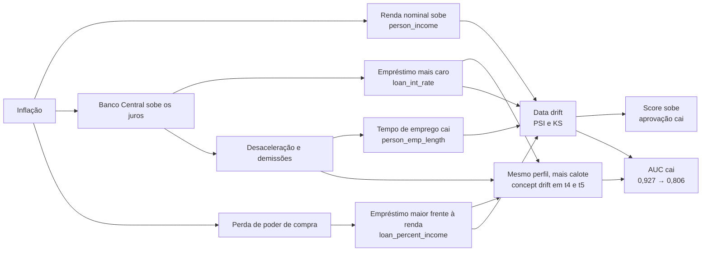

# Credit Risk: Sustentação e Confiabilidade em Produção

> Tech Challenge Fase 4 (MLET / FIAP Pós Tech): observabilidade contínua, detecção de
> drift, qualidade de dados e governança (LGPD) de um modelo de Credit Scoring.
>
> **Vídeo STAR (4:52):** [https://youtu.be/efrBXjaSIYo](https://youtu.be/efrBXjaSIYo)

O projeto é desenvolvido em quatro etapas. O status das tarefas e os responsáveis estão
em [TODO.md](TODO.md).

## Contexto

Uma fintech de crédito tem um modelo de Credit Scoring em produção. Com mudanças na
economia (inflação, juros, novos perfis de clientes), há suspeita de **degradação
silenciosa**. Este projeto constrói a camada que:

1. **impede dados ruins de chegar ao modelo** (data contracts);
2. **detecta Data Drift e Concept Drift** (PSI, KS, Evidently);
3. **dá visibilidade operacional** (logs, métricas de saúde, alertas);
4. **documenta a governança** (LGPD, vieses, análise causal).

## Começo rápido

```bash
uv sync
uv run python scripts/run_pipeline.py     # Etapas 1 a 4 de ponta a ponta (~1 min)
uv run pytest
```

Depois, abra [reports/monitoring/index.html](reports/monitoring/index.html) no navegador. O
CSV bruto já está versionado em `data/raw/` (licença CC0), então não é preciso conta no
Kaggle. O `run_pipeline.py` apaga e regrava `logs/`; os logs versionados são os da execução
final (T3.8).

## Mapa de evidências

Onde está a prova de cada critério de avaliação do enunciado.

| Critério | Peso | Evidência |
|---|---|---|
| Validação de dados | 25% | contrato em [src/credit_risk/contracts/schemas.py](src/credit_risk/contracts/schemas.py); bloqueio com exit code 1 em `scripts/validate_data.py --make-bad-batch`; regras violadas em [reports/validation/bad_batch_failures.csv](reports/validation/bad_batch_failures.csv); histórico em [logs/validation.jsonl](logs/validation.jsonl); testes em [tests/test_contracts.py](tests/test_contracts.py) |
| Detecção de drift | 25% | cenários em [configs/drift_scenarios.yaml](configs/drift_scenarios.yaml); relatórios Evidently em [reports/drift/](reports/drift/) (`drift_t1..t5.html`, `performance_t1..t5.html`); PSI e KS por feature em `psi_ks_t1..t5.csv`; resumo em [reports/drift/drift_summary.json](reports/drift/drift_summary.json) |
| Observabilidade e logs | 20% | painel em [reports/monitoring/index.html](reports/monitoring/index.html); logs em [logs/](logs/) (predições sem PII, validação e alertas); métricas Prometheus em [reports/monitoring/metrics.prom](reports/monitoring/metrics.prom); Grafana via `docker compose up`; página de demonstração do vídeo em [apresentacao/demo/](apresentacao/demo/) |
| Governança (LGPD) | 15% | seção [Etapa 4: Governança e LGPD](#etapa-4-governança-e-lgpd) deste README; vieses em [reports/training/fairness.csv](reports/training/fairness.csv) e [fairness_windows.csv](reports/training/fairness_windows.csv) |
| Vídeo STAR | 15% | [https://youtu.be/efrBXjaSIYo](https://youtu.be/efrBXjaSIYo) (4:52); detalhes na seção [Vídeo STAR](#vídeo-star); roteiro em [docs/roteiro-video-star.md](docs/roteiro-video-star.md) |

## Stack

| Função | Ferramenta |
|---|---|
| Modelo | scikit-learn + XGBoost |
| Data contracts | Pandera |
| Drift e relatórios | Evidently AI (testes PSI e KS) |
| Monitoramento | Painel HTML + Servidor HTTP + Prometheus + Grafana (Docker) |
| Ambiente | uv + pyproject.toml + Docker Compose |

## Como rodar

### Pré-requisitos

- Python 3.11 ou superior;
- `uv` instalado;
- acesso à internet só se quiser baixar o dataset de novo pelo KaggleHub.

O dataset é público e o download pelo KaggleHub funciona sem login. Se o Kaggle pedir
autenticação, configure-a localmente conforme a documentação do KaggleHub. Credenciais
e arquivos `.env` nunca devem ser adicionados ao repositório.

### Execução completa da Etapa 1

```bash
uv sync
uv run python scripts/download_data.py
uv run python scripts/prepare_data.py
uv run python scripts/validate_data.py --make-bad-batch
uv run python scripts/train_baseline.py
uv run pytest
```

O fluxo executa as seguintes operações:

1. `download_data.py` baixa o dataset público `laotse/credit-risk-dataset`, valida as
   colunas obrigatórias e salva o CSV em `data/raw/credit_risk_dataset.csv`;
2. `prepare_data.py` remove registros inválidos, cria identificadores internos e separa
   Referência e Produção em arquivos Parquet distintos;
3. `validate_data.py --make-bad-batch` gera um lote com violações intencionais, executa o
   contrato Pandera e demonstra o bloqueio com exit code `1`;
4. `train_baseline.py` valida a Referência, treina o XGBoost e salva as métricas e
   importâncias das features.

Para validar um lote já existente:

```bash
uv run python scripts/validate_data.py data/reference/reference.parquet --schema training
uv run python scripts/validate_data.py data/bad_batches/bad_batch.parquet --schema training
```

O segundo comando deve falhar com exit code `1`.

### Execução sem download automático

O CSV bruto já vem versionado em `data/raw/credit_risk_dataset.csv`, porque a licença do
dataset no Kaggle é CC0 (domínio público). Sem acesso ao Kaggle, pule o
`download_data.py` e comece pelo `prepare_data.py`.

### Artefatos gerados

| Caminho | Finalidade |
|---|---|
| `data/reference/reference.parquet` | Base de Referência usada no treino |
| `data/production/production_base.parquet` | Base de Produção separada |
| `data/bad_batches/bad_batch.parquet` | Lote inválido para demonstração |
| `reports/validation/bad_batch_failures.csv` | Evidência das regras violadas |
| `reports/training/metrics.json` | Métricas do baseline |
| `reports/training/feature_importance.csv` | Importância das features |
| `reports/training/fairness.csv` | Métricas de viés por faixa etária e tipo de moradia (Etapa 4) |
| `reports/training/fairness_windows.csv` | Métricas de viés por faixa etária em cada janela t1..t5 (Etapa 4) |
| `models/baseline_v1.joblib` | Modelo treinado localmente |

Os dados processados e os modelos não são versionados; a única exceção em `data/` é o CSV
bruto público (CC0). Os relatórios pequenos e reprodutíveis e os logs da execução final são
versionados como evidência.

## Dataset

O projeto usa o **Credit Risk Dataset**, disponibilizado publicamente no Kaggle por
`laotse/credit-risk-dataset`. O arquivo possui 32.581 registros antes da limpeza e as
colunas de idade, renda, emprego, empréstimo, taxa de juros, intenção, grau e histórico
de inadimplência. A limpeza remove 165 propostas duplicadas (comparadas sem o
`application_id`), 3.915 com campos nulos e 4 com idade acima de 100 anos. Após a limpeza e
a divisão determinística com seed 42, a base limpa possui 28.497 registros, a Referência
possui 17.098 registros e a Produção possui 11.399 registros, sem nenhuma proposta repetida
entre as duas.

O pipeline mantém a Referência e a Produção em arquivos físicos separados. O modelo
nunca é treinado com a Produção.

## Etapa 1: Validação de dados (data contracts)

O contrato Pandera bloqueia a ingestão quando ocorre qualquer violação. As regras rígidas
incluem idade entre 18 e 100 anos, renda não nula e dentro dos limites definidos,
ausência de duplicatas (pelo conteúdo, sem contar o ID, para que a mesma proposta com outro
ID também seja barrada), target binário e domínios válidos para variáveis categóricas.

O lote inválido é gerado por `scripts/validate_data.py --make-bad-batch`, que retorna
exit code 1, registra a falha em `logs/validation.jsonl` e gera a evidência em
`reports/validation/bad_batch_failures.csv`.

O baseline XGBoost é treinado exclusivamente com a Referência. As métricas estão em
`reports/training/metrics.json` e as importâncias em
`reports/training/feature_importance.csv`.

## Etapa 2: Simulação e detecção de drift

### Execução

```bash
uv run python scripts/simulate_drift.py   # gera data/production/t1..t5.parquet
uv run python scripts/predict.py          # valida pelo contrato, prediz e grava logs/predictions.jsonl
uv run python scripts/detect_drift.py     # relatórios Evidently em reports/drift/
uv run pytest tests/test_drift.py tests/test_drift_pipeline.py tests/test_inference.py
```

Os scripts aceitam `--window t3` (predição e detecção) para processar só uma janela.
Defina `PSEUDONYMIZATION_SALT` no `.env` e rode com `uv run --env-file .env python ...` (ou
exporte a variável no terminal) para que o `record_id` do log seja estável entre execuções;
sem ele, o script usa um salt aleatório por execução e o log continua sem PII.

### Simulação da passagem do tempo

`configs/drift_scenarios.yaml` descreve cinco janelas de produção com 5.000 propostas
cada, amostradas da base de Produção (nunca da Referência) com seed fixa. Cada mudança
tem uma justificativa econômica, que alimenta a análise causal da Etapa 4.

| Janela | Cenário | Data drift (P(X)) | Concept drift (P(y\|X)) |
|---|---|---|---|
| t1 | Controle | nenhum | nenhum |
| t2 | Início da inflação | renda ×1,10; juros +0,75 p.p. | nenhum |
| t3 | Inflação + juros | renda ×1,20; juros +2,5 p.p.; empréstimo/renda +0,03 | nenhum |
| t4 | Desaceleração | renda ×1,25; juros +4 p.p.; empréstimo/renda +0,06; tempo de emprego ×0,6 | 15% dos bons pagadores com empréstimo/renda > 0,25 passam a inadimplir |
| t5 | Crise | renda ×1,30; juros +5 p.p.; empréstimo/renda +0,08; tempo de emprego ×0,5 | 30% dos bons pagadores com empréstimo/renda > 0,25 passam a inadimplir |

As features alteradas foram escolhidas pela importância do baseline
(`reports/training/feature_importance.csv`): `loan_percent_income` e `loan_int_rate`
são as duas features numéricas mais importantes do modelo, e `person_income` e
`person_emp_length` completam o cenário de inflação e desemprego.

### Detecção

`scripts/detect_drift.py` compara a Referência com cada janela usando o **Evidently AI**:

- **PSI** por feature (`method="psi"`), classificado em `stable` (< 0,10), `warning`
  (0,10–0,25) e `drift` (> 0,25);
- **Kolmogorov-Smirnov** por feature numérica (`method="ks"`, drift se p-valor < 0,05);
- **prediction drift**: PSI do score do modelo;
- **performance** com o rótulo real (`ClassificationPreset`), para evidenciar o concept
  drift.

Uma feature é marcada com drift quando o PSI passa de 0,25 **ou** o p-valor do KS fica
abaixo de 0,05. O veredito de dataset drift do HTML usa o mesmo limiar dos alertas
(30% das features).

### Resultados

| Janela | Features com drift | Quais | PSI do score | Score médio | AUC | KS |
|---|---|---|---|---|---|---|
| t1 | 2/11 (18%) | `loan_amnt`, `loan_percent_income` | 0,003 | 0,217 | 0,929 | 0,725 |
| t2 | 3/11 (27%) | `person_income`, `loan_amnt`, `loan_int_rate` | 0,020 | 0,230 | 0,912 | 0,685 |
| t3 | 4/11 (36%) | `person_income`, `loan_amnt`, `loan_int_rate`, `loan_percent_income` | 0,213 | 0,293 | 0,892 | 0,659 |
| t4 | 5/11 (45%) | `person_income`, `person_emp_length`, `loan_amnt`, `loan_int_rate`, `loan_percent_income` | 0,550 | 0,377 | 0,845 | 0,573 |
| t5 | 4/11 (36%) | `person_income`, `person_emp_length`, `loan_int_rate`, `loan_percent_income` | 0,843 | 0,443 | 0,806 | 0,495 |

Na Referência, o score médio é 0,217. A AUC do baseline no holdout de validação é 0,927
([reports/training/metrics.json](reports/training/metrics.json)).

Leitura dos resultados:

- o drift cresce de t2 a t5 (o PSI de cada feature alterada sobe junto com a mudança
  aplicada, e o do score sobe a cada janela) e atinge todas as features alteradas na
  simulação;
- `person_income` é detectada pelo KS (p-valor ≈ 0), mas o PSI dela fica em 0,08 mesmo
  em t5: o PSI, calculado por faixas, foi pouco sensível a esse deslocamento, enquanto o
  KS compara a distribuição acumulada inteira. Por isso o projeto usa os dois testes;
- a AUC já cai com o data drift (0,929 em t1 para 0,892 em t3) e cai mais em t4 e t5,
  quando o data drift fica mais forte e entra o concept drift, que muda só o rótulo: 0,806
  em t5. A parte de cada um está na [análise causal](#análise-causal-da-degradação). O score
  médio dobra em relação à Referência (0,217 para 0,443);
- `loan_amnt` não é alterada pela simulação, mas o KS a marca de t1 a t4 (p-valor entre
  0,007 e 0,03), com PSI abaixo de 0,01. A divisão aleatória (seed 42) deixou a Produção com
  empréstimo médio 1,2% maior que a Referência (9.730 contra 9.611), e as janelas são
  sorteadas dessa base. Na janela de controle t1, o KS também marca `loan_percent_income`
  (p-valor 0,009) pelo mesmo motivo. Com amostras grandes, o KS detecta diferenças pequenas
  de amostragem; por isso o alerta considera a proporção de features, e não uma feature
  isolada, e t1 fica abaixo do limiar de 30%. Em t3, esse falso positivo soma uma feature
  às três alteradas e leva a janela a 36%.

### Evidências

| Caminho | Conteúdo |
|---|---|
| `reports/drift/drift_<janela>.html` | Relatório Evidently de data drift e prediction drift |
| `reports/drift/performance_<janela>.html` | Relatório Evidently de performance (concept drift) |
| `reports/drift/psi_ks_<janela>.csv` | PSI, p-valor do KS e status por feature |
| `reports/drift/drift_summary.json` | Resumo consumido pelo monitoramento (Etapa 3) |
| `logs/predictions.jsonl` | Log de predições sem PII (versionado só na execução final, T3.8) |

## Etapa 3: Observabilidade e monitoramento

A camada de observabilidade integra os logs operacionais de validação (`logs/validation.jsonl`) e de inferência sem PII (`logs/predictions.jsonl`) aos resultados estatísticos de drift (`reports/drift/drift_summary.json`), produzindo alertas automatizados (`logs/alerts.jsonl`) e o painel consolidado (`reports/monitoring/index.html`).

### Execução

```bash
uv run python scripts/monitor.py
uv run pytest tests/test_monitoring.py
```

Para executar todo o pipeline ponta a ponta (Etapas 1 a 4):

```bash
uv run python scripts/run_pipeline.py
```

### Registro centralizado de predições sem PII (`T3.1`)

O módulo `src/credit_risk/monitoring/prediction_logger.py` implementa `log_predictions` e `read_predictions`, garantindo que cada linha gravada em `logs/predictions.jsonl` contenha exclusivamente os campos autorizados (`timestamp`, `window`, `record_id`, `score`, `decision`, `latency_ms`, `model_version`) e que `record_id` seja obrigatoriamente um hash SHA-256 hexadecimal de 64 caracteres (bloqueando qualquer tentativa de gravar identificadores originais ou PII).

### Métricas de saúde operacionais e do modelo (`T3.2` e `T3.6`)

O módulo `src/credit_risk/monitoring/health.py` consolida os artefatos de inferência, validação e drift em uma tabela por janela (`compute_health`), cobrindo quatro dimensões de observabilidade:

| Dimensão | Métricas calculadas | Finalidade operacional |
|---|---|---|
| **Saúde operacional do pipeline** | `volume`, `null_predictions_pct`, `n_batches`, `n_blocked_batches`, `blocked_batches_pct`, `latency_p50_ms`, `latency_p95_ms` | Detectar falhas de execução em micro-lotes, violações de contrato bloqueadas pelo Pandera e degradação de tempo de resposta |
| **Prediction drift** | `mean_score`, `reference_mean_score`, `approval_rate`, `prediction_psi` | Monitorar deslocamento na distribuição das probabilidades de default e na taxa de concessão de crédito antes da chegada do rótulo real |
| **Data drift** | `n_features`, `n_drifted`, `share_drifted`, `drifted_features` | Quantificar a proporção de variáveis de entrada que sofreram mudança estatística (PSI > 0,25 ou KS p-valor < 0,05) |
| **Performance (Concept drift)** | `auc`, `reference_auc`, `auc_drop`, `ks`, `gini` | Medir a perda de poder discriminante do classificador frente à mudança na relação `P(y\|X)` |

### Regras de alerta de degradação (`T3.3`)

O módulo `src/credit_risk/monitoring/alerts.py` avalia a tabela de saúde contra os limiares de `src/credit_risk/config.py` e registra os eventos em `logs/alerts.jsonl`:

| Tipo (`type`) | Métrica (`metric`) | Regra de disparo | Severidade |
|---|---|---|---|
| `contract_blocked` | `blocked_batches_pct` | `> 0%` na janela ou lote reprovado no contrato (`bad_batch`) | `critical` |
| `data_drift` | `share_drifted` | `≥ 30%` das features com drift (`ALERT_DRIFT_SHARE`) | `critical` |
| `prediction_drift` | `prediction_psi` | `0,10–0,25` (`PSI_WARNING`) ou `> 0,25` (`PSI_DRIFT`) | `warning` / `critical` |
| `performance_drop` | `auc_drop` | Queda de AUC `> 0,05` (`ALERT_AUC_DROP`) | `warning` / `critical` |
| `null_predictions` | `null_predictions_pct` | `> 1%` de predições nulas/erro (`ALERT_NULL_PREDICTIONS_PCT`) | `warning` / `critical` |
| `latency` | `latency_p95_ms` | Latência p95 `> 200 ms` (`ALERT_LATENCY_P95_MS`) | `warning` / `critical` |

Nas janelas simuladas (`t1` a `t5`) e na validação do lote inválido (`bad_batch`), o monitoramento identifica:
- **`bad_batch`**: alerta `contract_blocked` (`critical`) pelo bloqueio preventivo das 8 violações de contrato;
- **`t1` e `t2`**: operação saudável, sem alertas disparados (`share_drifted` em 18,2% e 27,3%, abaixo de 30%, e `prediction_psi` < 0,10);
- **`t3`**: alertas `data_drift` (`critical`, 36,4% das features com drift) e `prediction_drift` (`warning`, PSI do score = 0,213), sinalizando o deslocamento de score provocado pela alta de juros e comprometimento de renda antes da queda de AUC passar do limite;
- **`t4`**: alertas `data_drift` (`critical`, 45,5% das features com drift), `prediction_drift` (`critical`, PSI do score = 0,550) e `performance_drop` (`warning`, queda de AUC = 0,082);
- **`t5`**: alertas `data_drift` (`critical`, 36,4% das features com drift), `prediction_drift` (`critical`, PSI do score = 0,843) e `performance_drop` (`critical`, queda de AUC = 0,121).

No total são 9 alertas: 7 críticos e 2 de atenção.

### Painel HTML e artefatos de monitoramento (`T3.4` e `T3.5`)

O módulo `src/credit_risk/monitoring/dashboard.py` e o entrypoint `scripts/monitor.py` geram [reports/monitoring/index.html](reports/monitoring/index.html), reunindo:
1. **KPIs executivos** e **Tabela de Métricas de Saúde por Janela (`t1`..`t5`)**, com destaque visual (`cell-warning` e `cell-critical`) nas métricas que cruzam os limiares;
2. **Tabela de Alertas de Degradação e Qualidade**, exibindo severidade, tipo, valor observado vs. threshold e descrição;
3. **Links diretos para as evidências**, apontando para os relatórios HTML do Evidently (`reports/drift/drift_<janela>.html` e `performance_<janela>.html`), tabelas `psi_ks_<janela>.csv` e falhas do contrato (`reports/validation/bad_batch_failures.csv`).

| Caminho | Conteúdo |
|---|---|
| `reports/monitoring/index.html` | Painel visual consolidado de saúde, alertas e links para relatórios Evidently |
| `reports/monitoring/metrics.prom` | Métricas de saúde e alertas exportadas no formato OpenMetrics/Prometheus |
| `logs/validation.jsonl` | Histórico centralizado de lotes aprovados e bloqueados pelo contrato Pandera |
| `logs/predictions.jsonl` | Log centralizado de predições por janela, pseudonimizado (SHA-256 + salt) e sem PII |
| `logs/alerts.jsonl` | Alertas estruturados disparados pelas regras de degradação e qualidade |
| `tests/fixtures/mocks/` | Mocks dos contratos de interface (`T3.0`) para testes unitários rápidos da Etapa 3 |

### Página de demonstração do vídeo (`apresentacao/demo/`)

O vídeo usa uma página com a marca fictícia "vértice": o app do cliente fica à esquerda e a
Central de Risco à direita. Ela não tem números próprios. O `build_data.py` gera o `data.js`
a partir de `logs/` e `reports/`, e o [tests/test_demo_page.py](tests/test_demo_page.py)
confere que os números da página batem com esses artefatos e que nenhum ID completo aparece.

| Arquivo | O que faz |
|---|---|
| `index.html`, `styles.css` | a página, com 5 cenas (setas do teclado ou botão "Próxima etapa") |
| `data.js` | números da execução final, gerados pelo `build_data.py` (não edite à mão) |
| `build_data.py` | lê `logs/*.jsonl`, `reports/training/metrics.json` e `reports/drift/drift_summary.json`; com `data/` local, inclui também os histogramas de `loan_int_rate` |
| `serve.py` | servidor local opcional. Com ele, o modelo responde ao vivo, o celular sorteia clientes com o drift da janela aplicado (D17) e o botão "Testar lote com erro" roda o contrato de verdade (D18) |

```bash
uv run python apresentacao/demo/build_data.py   # regrava o data.js depois de rodar o pipeline
uv run python apresentacao/demo/serve.py        # http://127.0.0.1:8765/?cena=1 (precisa de models/ e data/)
```

Sem o `serve.py`, basta abrir `apresentacao/demo/index.html` no navegador. A página usa os
números do `data.js`, e o terminal da cena 1 repete a saída do log ("replay do log"). As
fontes e os ícones vêm de CDN. O `serve.py` não deixa nada novo em `logs/`: depois do teste do
contrato, `logs/validation.jsonl` e `reports/validation/` voltam ao conteúdo de antes.

### Servidor de Observabilidade, Docker, Prometheus e Grafana (`T3.7`)

> 📖 **Guia didático completo da Etapa 3:** consulte [docs/etapa-3-observabilidade.md](docs/etapa-3-observabilidade.md) para uma explicação simplificada e passo a passo de toda a arquitetura de observabilidade construída.

Além de gerar os arquivos estáticos em `reports/monitoring/`, o projeto inclui um **Servidor HTTP Unificado** (`src/credit_risk/monitoring/server.py`), um `Dockerfile` e um `docker-compose.yml` que sobem 3 serviços integrados (`monitor`, `prometheus` e `grafana`) com provisioning automático:

| Serviço / Rota | URL | O que entrega |
|---|---|---|
| **Painel Principal (`monitor`)** | `http://localhost:8000/` | Redireciona para `/monitoring/index.html` com KPIs, tabela de saúde, alertas e links |
| **Relatórios Evidently (`monitor`)** | `http://localhost:8000/drift/drift_t1.html` | Serve todos os HTMLs e CSVs de `reports/` (`drift_t1..t5.html`, `performance_t1..t5.html`, `bad_batch_failures.csv`) |
| **API JSON de Saúde (`monitor`)** | `http://localhost:8000/api/health` | JSON com todas as métricas operacionais, de drift e de performance das janelas `t1`..`t5` |
| **API JSON de Alertas (`monitor`)** | `http://localhost:8000/api/alerts` | JSON com todos os alertas disparados (`critical` e `warning`) |
| **Exporter Prometheus (`monitor`)** | `http://localhost:8000/metrics` | Gauges `credit_risk_*` no padrão OpenMetrics coletados pelo Prometheus |
| **Prometheus UI (`prometheus`)** | `http://localhost:9090/` | Interface de consulta PromQL conectada automaticamente ao container `monitor:8000` |
| **Grafana (`grafana`)** | `http://localhost:3000/` | Abre direto no dashboard **Credit Risk — Observabilidade, Drift e Saúde** pré-carregado (acesso anônimo habilitado ou login `admin`/`admin`) |

#### Como rodar com Docker Compose (Monitor + Prometheus + Grafana)

```bash
# Subir toda a stack em background
docker compose up --build -d

# Verificar status e logs dos containers
docker compose ps
docker compose logs -f monitor

# Encerrar a stack
docker compose down
```

#### Como rodar apenas o servidor HTTP localmente (sem Docker)

```bash
uv run python scripts/monitor.py --serve --host 0.0.0.0 --port 8000
```

## Etapa 4: Governança e LGPD

Esta seção é o plano de proteção de dados do projeto. O dataset é público (licença CC0) e,
segundo o autor, simula dados de bureau de crédito, então não há titulares reais. Mesmo
assim, o pipeline trata cada proposta como se fosse de um cliente real: a privacidade é o
comportamento padrão do código, e não um passo manual.

### Tratamento de dados pessoais (PII)

**Inventário das colunas.** O dataset não tem identificadores diretos (nome, CPF,
endereço, telefone). As colunas que restam ainda são dados pessoais quando ligadas a uma
proposta, porque combinadas podem identificar alguém (art. 5º, I, da LGPD).

| Coluna | Categoria | Uso no projeto | Tratamento |
|---|---|---|---|
| `application_id` | identificador interno criado em `data/load.py` (`application_<n>`), sem relação com o titular | rastrear a proposta no pipeline | nunca sai em claro: logs e relatórios recebem o hash SHA-256 com salt |
| `person_age` | quasi-identificador; atributo com risco de discriminação | feature (1,5% da importância) | medição de viés por faixa etária (ver "Mitigação de vieses") |
| `person_income`, `person_emp_length` | dado financeiro e profissional | features | só agregados em relatórios |
| `person_home_ownership` | quasi-identificador socioeconômico | feature (22% da importância) | medição de viés por tipo de moradia |
| `loan_intent` | finalidade do empréstimo; o valor `MEDICAL` pode revelar informação de saúde, que é dado sensível (art. 5º, II) | feature | tratado como potencialmente sensível: só a categoria, nunca em log, só agregados |
| `loan_amnt`, `loan_int_rate`, `loan_percent_income`, `loan_grade` | dados da operação de crédito | features | só agregados em relatórios |
| `cb_person_default_on_file`, `cb_person_cred_hist_length` | histórico de crédito (bureau) | features | só agregados; prazos da Lei 12.414/2011 e do CDC no plano de retenção |
| `loan_status` | resultado do empréstimo (default) | target | só para treino e para medir performance |

**Controles aplicados.**

| Controle | Onde | Efeito |
|---|---|---|
| Minimização | [`privacy.minimize_columns`](src/credit_risk/data/privacy.py), chamada em `prepare_data.py` | só seguem `application_id`, as 11 features e o target; qualquer coluna extra da origem é descartada |
| ID interno sem dado pessoal | [`data/load.py`](src/credit_risk/data/load.py) | o identificador é um contador, não um documento do cliente |
| Pseudonimização (SHA-256 + salt) | [`privacy.pseudonymize_id`](src/credit_risk/data/privacy.py), usada em [`inference.py`](src/credit_risk/inference.py) | o `record_id` do log não volta ao ID sem o salt, que fica no `.env` (`PSEUDONYMIZATION_SALT`) e nunca é versionado |
| Log com lista fechada de campos | [`monitoring/prediction_logger.py`](src/credit_risk/monitoring/prediction_logger.py) | só 7 campos; um `record_id` que não seja hash de 64 caracteres é rejeitado |
| Relatório de falhas sem ID em claro | [`contracts/validator.py`](src/credit_risk/contracts/validator.py) | o ID duplicado do lote ruim sai pseudonimizado em `reports/validation/bad_batch_failures.csv` |
| Dados e modelos fora do Git | [`.gitignore`](.gitignore) | `data/` e `models/` não são versionados; a única exceção é o CSV bruto público (CC0) |
| Relatórios só com agregados | `reports/` | drift, monitoramento e fairness mostram distribuições e taxas por grupo, nunca linhas; grupos com menos de 30 propostas saem só com o volume |

**Auditoria dos artefatos versionados.** Antes da entrega, `logs/` e `reports/` foram
varridos em busca de `application_id` em claro: nenhuma ocorrência na versão atual. Os
25.000 `record_id` de `logs/predictions.jsonl` são hashes de 64 caracteres. O histórico do
Git ainda guarda uma versão antiga do relatório do lote ruim com um ID em claro
(`application_00009043`); é um contador sintético de um dataset público, não um dado pessoal,
e por isso não exige reescrever o histórico.

**Privacy by Design e by Default.** Cada princípio do art. 6º da LGPD vira um comportamento
padrão do pipeline:

| Princípio (art. 6º) | Como o pipeline aplica por padrão |
|---|---|
| Finalidade e adequação | os dados só servem para decidir e monitorar crédito; a faixa etária e o tipo de moradia servem também para medir viés |
| Necessidade | minimização de colunas na entrada; o log guarda score e decisão, não as features |
| Livre acesso | o titular consulta, pelo encarregado de dados, a forma e a duração do tratamento; o `record_id` localiza as decisões dele no log |
| Qualidade dos dados | o contrato Pandera bloqueia lotes inválidos antes do modelo |
| Transparência | importância das features em `reports/training/feature_importance.csv` e critérios documentados neste README |
| Segurança e prevenção | pseudonimização, segredos no `.env`, dados fora do Git e alertas automáticos |
| Não discriminação | relatório de vieses gerado a cada execução do pipeline |
| Responsabilização | logs de validação, predição e alertas versionados na execução final, para auditoria |

### Base legal da decisão de crédito

| Fundamento | Dispositivo | Aplicação no projeto |
|---|---|---|
| **Proteção do crédito** (base principal) | LGPD, art. 7º, X | analisar o risco de quem pede crédito é a finalidade central do modelo |
| Procedimentos preliminares de contrato | LGPD, art. 7º, V | a análise acontece porque o titular pediu o empréstimo |
| Revisão de decisão automatizada | LGPD, art. 20, caput e §1º | o titular pode pedir revisão da decisão e informações claras sobre os critérios |
| Princípios | LGPD, art. 6º (finalidade, necessidade, não discriminação) | ver "Privacy by Design e by Default" e "Mitigação de vieses" |
| Segurança | LGPD, art. 46 | controles técnicos da tabela acima |
| Histórico de crédito | Lei 12.414/2011 (Cadastro Positivo) | as colunas `cb_person_*` vêm de bureau e seguem os prazos dessa lei |

O consentimento não foi escolhido como base: ele pode ser revogado a qualquer momento, o
que inviabilizaria a análise de risco e a auditoria da decisão.

**Revisão (art. 20).** A decisão é automática, então o processo de revisão precisa existir
desde o início:

- o `record_id` localiza a decisão no log sem expor o ID; só a fintech, com o salt,
  consegue ligar o hash à proposta;
- o log guarda o score, a decisão, o horário e a versão do modelo, o que permite reproduzir
  a decisão;
- os critérios gerais estão em `reports/training/feature_importance.csv`: grau do
  empréstimo, tipo de moradia, finalidade, valor do empréstimo sobre a renda e taxa de juros
  pesam mais;
- a revisão é feita por um analista de crédito, não pelo próprio modelo.

**Direitos do titular (art. 18).** O encarregado de dados atende a confirmação do
tratamento e o acesso aos dados (incisos I e II), a correção (III), a anonimização, o
bloqueio ou a eliminação de dados desnecessários (IV), a portabilidade (V) e a informação
sobre compartilhamento (VII). Os incisos ligados ao consentimento (VI, VIII e IX) não se
aplicam, porque a base legal é a proteção do crédito.

**Ressalva sobre dado sensível.** O art. 11 lista as bases para dados sensíveis, e a
proteção do crédito não está entre elas. Por isso, `loan_intent = MEDICAL` foi tratado como
a finalidade declarada do empréstimo (não um diagnóstico) e mantido só como categoria. Se o
encarregado de dados concluir que é dado de saúde, a saída é generalizar a categoria (por
exemplo, juntar com `PERSONAL`) ou removê-la e retreinar o modelo.

**Papéis de governança.**

| Papel | Responsabilidade |
|---|---|
| Dono do modelo | aprova retreino e rollback; define os limiares de alerta |
| Engenharia de ML | mantém pipeline, contratos, monitoramento e relatório de vieses |
| Encarregado de dados (DPO) | valida base legal, retenção, dado sensível e atendimento aos titulares |
| Risco e compliance | revisa vieses e o impacto da decisão automatizada; conduz as revisões do art. 20 |

### Plano de retenção

Ao fim do tratamento, os dados pessoais são eliminados (LGPD, art. 16). As exceções usadas
são a obrigação legal (art. 16, I) e o uso exclusivo do controlador com dados anonimizados
(art. 16, IV). Dados anonimizados deixam de ser dados pessoais (art. 12).

| Dado | Onde | Prazo | Justificativa | Ao fim do prazo |
|---|---|---|---|---|
| CSV bruto público | `data/raw/` | enquanto o projeto existir | dataset público (CC0), sem titulares reais | — |
| Referência (treino) | `data/reference/` | vida do modelo + 5 anos | reproduzir e auditar o modelo; prazo mínimo de guarda de cadastros (Lei 9.613/1998, art. 10, §2º) | eliminar ou anonimizar |
| Base e janelas de produção | `data/production/` | período de monitoramento (12 meses) | detectar drift e medir performance quando o rótulo chega | eliminar |
| Lote ruim de demonstração | `data/bad_batches/` | só durante a demonstração | gerado sob demanda por `validate_data.py --make-bad-batch` | eliminar |
| Log de predições (pseudonimizado) | `logs/predictions.jsonl` | 5 anos após a decisão | revisão do art. 20 e auditoria; mesmo prazo mínimo da Lei 9.613/1998 | eliminar |
| Informação negativa (inadimplência) | `cb_person_default_on_file` | no máximo 5 anos | limite do CDC, art. 43, §1º | eliminar |
| Histórico de crédito (adimplemento) | `cb_person_cred_hist_length` | no máximo 15 anos | limite da Lei 12.414/2011, art. 14 | eliminar |
| Logs de validação e alertas | `logs/validation.jsonl`, `logs/alerts.jsonl` | prazo de auditoria do modelo | não têm dado pessoal | manter ou eliminar |
| Modelo treinado | `models/` | vida do modelo + 5 anos | auditoria e rollback | eliminar |
| Relatórios agregados | `reports/` | indeterminado | histórico de monitoramento, sem dado pessoal (art. 12) | manter |

Os prazos legais foram conferidos no texto vigente publicado no Planalto. Num cenário real,
o encarregado de dados valida cada prazo contra as normas do Banco Central aplicáveis à
fintech.

**Logs no Git.** As cópias de `logs/` e `reports/` neste repositório são a evidência da
demonstração: dataset público, IDs pseudonimizados e nenhum titular real. Como o histórico
do Git é permanente, em produção esses logs ficariam num armazenamento com expurgo
automático no fim de cada prazo, e não no repositório.

### Mitigação de vieses

`scripts/bias_report.py` mede o modelo por faixa etária e por tipo de moradia no mesmo
holdout de validação da Referência usado nas métricas do baseline (3.420 propostas que o
modelo não viu no treino). A faixa etária é derivada de `person_age` só para a análise e
não entra no modelo. Um grupo é marcado quando a taxa de aprovação dele fica abaixo de 80%
da maior taxa (a "regra dos 4/5"). Grupos com menos de 30 propostas não são marcados e
saem só com o volume: as taxas ficam vazias para o relatório não expor grupos quase
individuais.

| Grupo | n | Aprovação | Default real | Score médio | AUC | Inadimplente aprovado (FNR) | Bom pagador negado (FPR) | Razão de aprovação | Marcado |
|---|---|---|---|---|---|---|---|---|---|
| 18–25 anos | 1.606 | 82,8% | 22,2% | 0,225 | 0,944 | 24,7% | 0,6% | 0,97 | não |
| 26–35 anos | 1.450 | 84,4% | 21,7% | 0,213 | 0,908 | 30,2% | 0,5% | 0,99 | não |
| 36–45 anos | 286 | 85,3% | 18,9% | 0,198 | 0,942 | 24,1% | 0,4% | 1,00 | não |
| 46–60 anos | 71 | 84,5% | 23,9% | 0,187 | 0,909 | 35,3% | 0,0% | 0,99 | não |
| 61+ anos | 7 | — | — | — | — | — | — | — | não (grupo pequeno) |
| `MORTGAGE` | 1.411 | 94,4% | 12,6% | 0,120 | 0,840 | **56,7%** | 0,2% | 0,97 | não |
| `OWN` | 248 | 97,2% | 2,4% | 0,039 | 0,999 | 16,7% | 0,8% | 1,00 | não |
| `RENT` | 1.745 | 73,2% | 31,8% | 0,320 | 0,949 | 17,7% | 0,9% | **0,75** | **sim** |
| `OTHER` | 16 | — | — | — | — | — | — | — | não (grupo pequeno) |

Fonte: [reports/training/fairness.csv](reports/training/fairness.csv).

Leitura:

- **Idade:** todas as faixas com volume suficiente ficam com razão de aprovação de 0,97 ou
  mais, AUC parecida e menos de 1% de bons pagadores negados. As faixas acima de 45 anos
  têm pouco volume para conclusões fortes.
- **Tipo de moradia:** quem paga aluguel (`RENT`) é aprovado em 73,2% dos casos, contra
  97,2% de quem tem casa própria e 94,4% de quem tem financiamento, e cai abaixo da regra dos
  4/5 (razão de 0,75). O modelo, porém, está calibrado nesse grupo: o score médio (0,320)
  acompanha o default real (31,8%), e a taxa de bons pagadores negados é de 0,9%. A
  diferença de aprovação vem do risco observado nos dados. O erro, porém, não é igual entre os grupos: entre os inadimplentes, 56,7% dos que
  têm financiamento (`MORTGAGE`) são aprovados, contra 17,7% dos que pagam aluguel, e a AUC
  de `MORTGAGE` (0,840) é a menor entre os grupos. O modelo é mais leniente com quem tem
  financiamento, então a igualdade de oportunidade (erro parecido entre grupos) não se
  sustenta, mesmo com a regra dos 4/5 olhando só a aprovação. Além disso, o tipo de moradia
  é a segunda feature mais importante e funciona como proxy de renda e patrimônio. Por isso
  fica sob monitoramento e revisão.
- **Na crise simulada** ([reports/training/fairness_windows.csv](reports/training/fairness_windows.csv)),
  a taxa de bons pagadores negados sobe de no máximo 1,1% em t1 para 23% a 27% em t5 em
  todas as faixas etárias com volume. Os jovens (18–25 anos) têm a menor aprovação em t5
  (57,9%), e a razão deles cai de 0,96 em t1 para 0,88, ainda acima da regra dos 4/5. A crise atinge todos os grupos, e o drift também
  vira um problema de justiça: muito mais bons pagadores passam a ser negados.

Medidas adotadas:

- atributos sensíveis (gênero, raça, estado civil) não existem no dataset e não seriam
  usados como feature;
- a idade foi mantida como feature (1,5% da importância) com medição de viés a cada
  execução; retirá-la refaria todas as evidências das Etapas 1 a 3 (decisão D9, em
  [docs/plano-etapa-4.md](docs/plano-etapa-4.md#6-decisões-a-tomar));
- `loan_intent = MEDICAL` foi tratado como potencialmente sensível (ver "Base legal");
- o relatório de vieses faz parte do `run_pipeline.py`, então roda sempre junto com o
  drift.

Medidas propostas para produção:

- alertar quando um grupo cair abaixo da regra dos 4/5 numa janela, como já acontece com o
  drift, e acompanhar também o FNR e o FPR por grupo, e não só a aprovação;
- revisão humana obrigatória para scores perto do corte (por exemplo, entre 0,4 e 0,6) e
  para recusas em grupos marcados;
- testar uma versão do modelo sem `person_home_ownership` e sem `person_age` e comparar a
  AUC com a disparidade de cada versão;
- recalibrar o corte de aprovação depois da crise, porque a taxa de bons pagadores negados
  explode em t4 e t5.

### Análise causal da degradação

A simulação é uma intervenção controlada: cada mudança tem uma justificativa econômica em
[configs/drift_scenarios.yaml](configs/drift_scenarios.yaml). Por isso dá para ligar causa
e efeito, o que o monitoramento sozinho não permitiria.



**Da causa ao efeito medido (janela t5, a crise).**

| Causa simulada | Feature | Mudança aplicada | Efeito medido pelo Evidently |
|---|---|---|---|
| Alta dos juros | `loan_int_rate` | +5 p.p. | PSI 3,99; KS p-valor ≈ 0 |
| Endividamento (empréstimo maior frente à renda) | `loan_percent_income` | +0,08 | PSI 1,56; KS p-valor ≈ 0 |
| Demissões | `person_emp_length` | ×0,5 | PSI 0,56; KS p-valor ≈ 0 |
| Inflação | `person_income` | ×1,30 | PSI 0,08 (estável); KS p-valor ≈ 0 (drift) |
| Perda de poder de compra | `loan_status` | 30% dos bons pagadores com empréstimo/renda > 0,25 passam a inadimplir (7,8% dos rótulos de t5) | AUC 0,806; KS do modelo 0,49 |

As features que não foram alteradas (`person_age`, `loan_amnt`, `cb_person_cred_hist_length`
e as categóricas) ficam estáveis em t5, com PSI abaixo de 0,01.

**Limitação da simulação.** No dataset, `loan_percent_income` é o valor do empréstimo
dividido pela renda (a conta fecha em 98,7% das linhas da Referência). A simulação desloca
essa coluna sozinha: em t5 a renda sobe 30% sem mudar `loan_amnt`, e a média da coluna vai a
0,251, quando o recálculo daria 0,132. O deslocamento representa mais endividamento, mas
quebra a relação entre as três colunas. Uma próxima versão deveria derivar a coluna de
`loan_amnt` e `person_income` depois de aplicar o drift.

**Separando data drift de concept drift com os próprios números.**

- **t1 → t3, só data drift:** a AUC cai de 0,929 para 0,892 (−0,037). As features mudam,
  mas a relação entre perfil e calote é a mesma.
- **t3 → t5, data drift mais forte e concept drift juntos:** a AUC cai de 0,892 para 0,806
  (−0,086). Para separar os dois efeitos, as mesmas janelas (seed 42, mesmo modelo) foram
  geradas de novo sem as mudanças `concept_drift` do YAML. Nesse contrafactual, a AUC fica
  em 0,871 em t4 e 0,859 em t5. Então, da queda de 0,086, cerca de 0,03 vem do data drift
  mais forte e cerca de 0,05 do concept drift, que nenhum teste de feature enxerga: ele
  muda só 7,8% dos rótulos de t5 e sozinho tira cerca de 0,05 de AUC.
- **O score avisa antes do rótulo:** em t3, o data drift (36% das features) e o PSI do
  score (0,213, atenção) já disparam alertas, quando a queda da AUC (0,036) ainda fica
  abaixo do limite de alerta de 0,05. Em produção, o rótulo real chega meses depois, então
  esses são os sinais antecipados.

<details>
<summary>Como reproduzir o contrafactual</summary>

Depois de rodar o pipeline (precisa de `data/` e `models/`):

```python
import copy, joblib, pandas as pd
from sklearn.metrics import roc_auc_score
from credit_risk import config
from credit_risk.drift.scenarios import build_windows, load_scenarios

base = pd.read_parquet(config.PRODUCTION_DIR / "production_base.parquet")
scenarios = load_scenarios(config.DRIFT_SCENARIOS_FILE)
only_data = copy.deepcopy(scenarios)
for window in only_data["windows"]:
    window["changes"] = [c for c in window.get("changes", []) if c["type"] != "concept_drift"]
model = joblib.load(config.MODEL_FILE)
for name, frame in build_windows(base, only_data).items():
    score = model.predict_proba(frame[config.FEATURES])[:, 1]
    print(name, round(roc_auc_score(frame[config.TARGET], score), 3))
```

</details>

**Correlação × causalidade.** Aqui sabemos a causa porque fomos nós que a aplicamos. Em
produção, o monitoramento só mostra associação: o juro subiu e a AUC caiu na mesma janela.
Para confirmar a causa, seria preciso cruzar as janelas com indicadores externos (IPCA,
Selic, desemprego), comparar com um grupo de controle e testar cenários contrafactuais (o
que o modelo faria com o juro antigo).

**Prescrição.**

| Ação | Gatilho | Quem decide |
|---|---|---|
| Retreinar com rótulos recentes | `performance_drop` crítico (t5) | dono do modelo |
| Recalibrar o score e revisar o corte de aprovação | `prediction_drift` crítico e taxa de bons pagadores negados em alta | dono do modelo, com risco e compliance |
| Usar renda real (deflacionada) como feature | drift persistente em `person_income` | engenharia de ML |
| Ampliar o contrato com faixa plausível de `loan_int_rate` | juros fora do histórico da Referência | engenharia de ML, com aprovação do dono do modelo |
| Revisar a política para os grupos afetados | grupo abaixo da regra dos 4/5 | risco e compliance, com o encarregado de dados |
| Revisão humana das decisões contestadas | pedido do titular (art. 20) | analista de crédito |

## Vídeo STAR

- **Link:** [https://youtu.be/efrBXjaSIYo](https://youtu.be/efrBXjaSIYo)
- **Título:** Credit Risk Monitoring | Pandera, Evidently AI e XGBoost (FIAP ML Engineer – Fase 4)
- **Duração:** 4:52, no formato STAR (Situation, Task, Action, Result).
- **Roteiro:** [docs/roteiro-video-star.md](docs/roteiro-video-star.md), com a fala, a tela
  e o tempo de cada bloco (meta de ~4:45, limite de 4:59).

## Equipe

| Integrante | RM | Etapa |
|---|---|---|
| Eduardo Aleixo dos Santos | 373692 | Etapa 1: dados, contratos e baseline |
| Vinicius Solon | 371660 | Etapa 2: simulação e detecção de drift |
| Fernando Azevedo | 373001 | Etapa 3: observabilidade e monitoramento |
| Vitor Luís da Silva | 370260 | Etapa 4: governança, documentação e vídeo |
