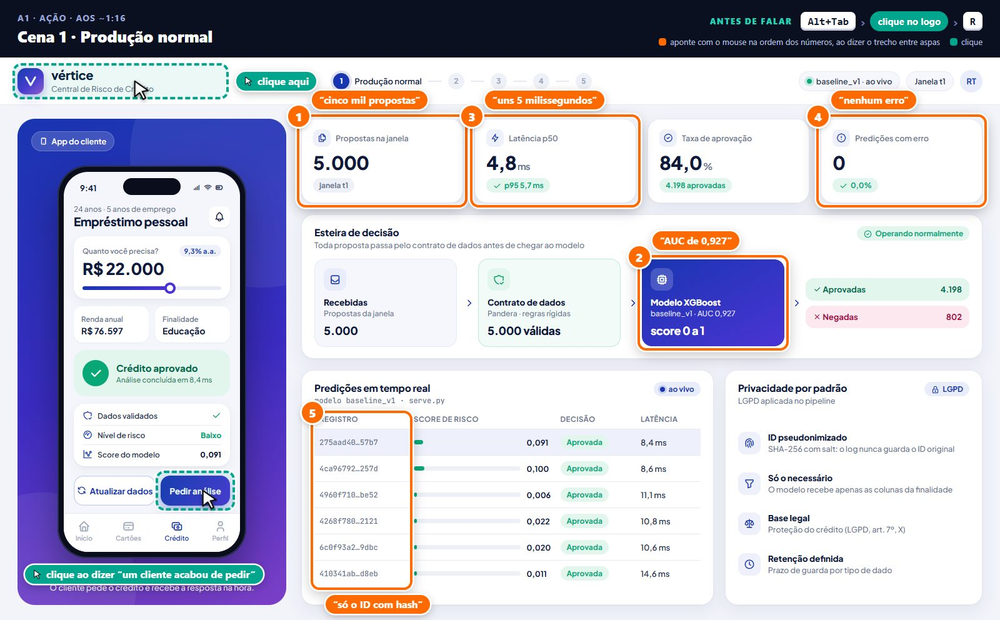
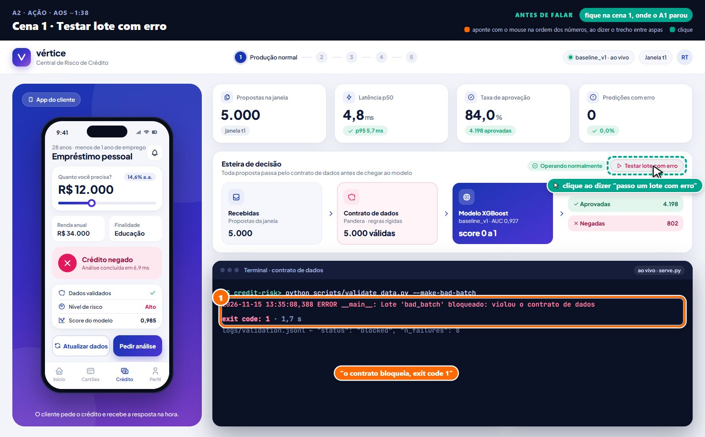
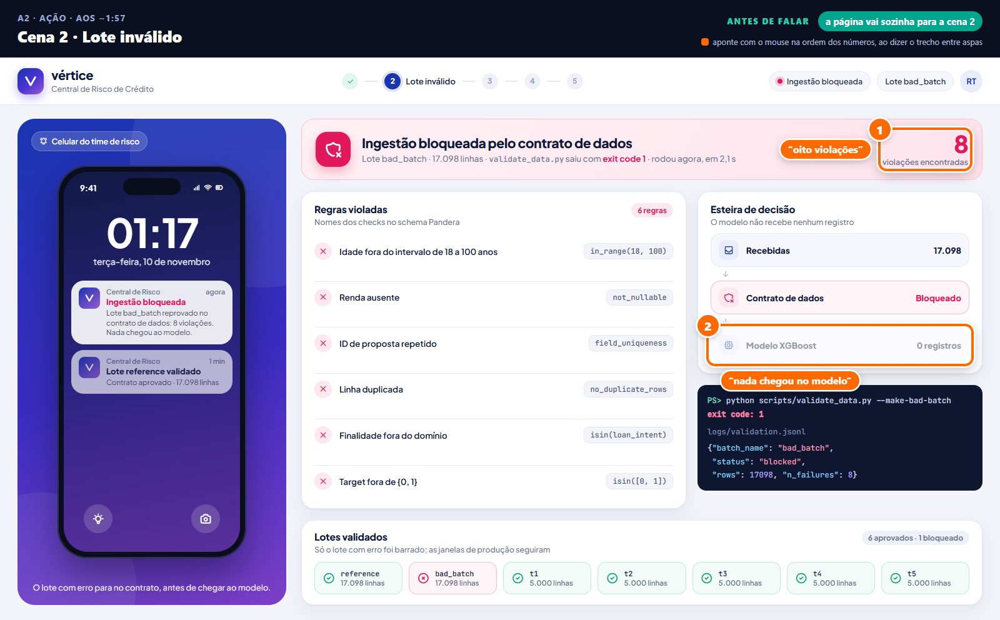
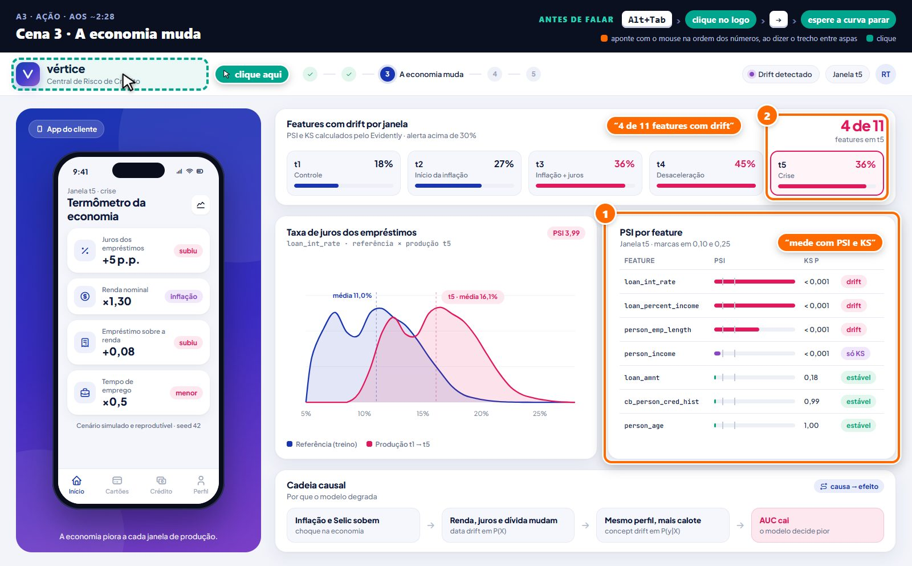
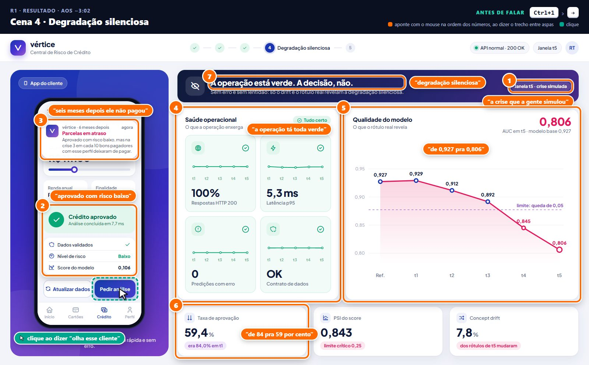
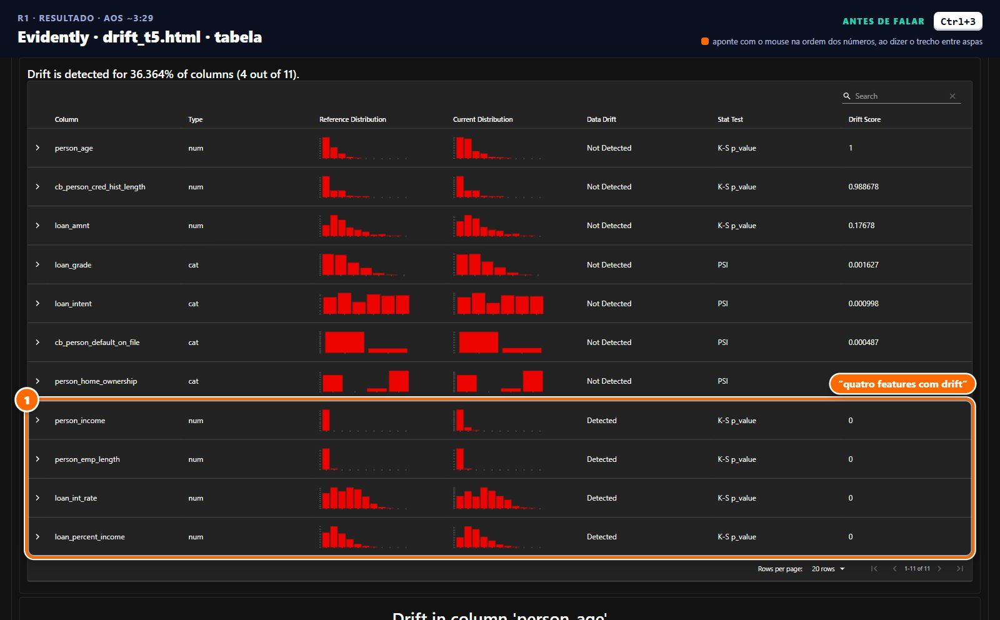
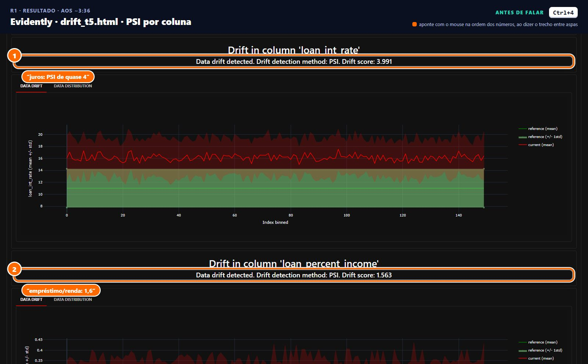
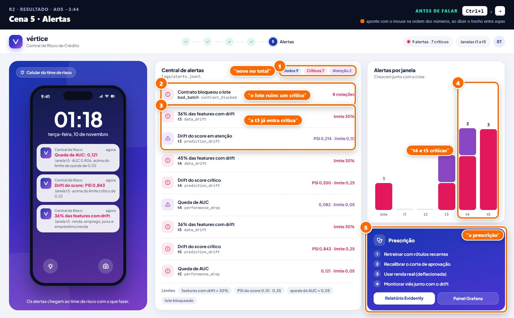

# Roteiro do vídeo STAR (T4.6)

Roteiro de gravação do vídeo da Fase 4. Ele traz a fala completa do apresentador, o que
aparece na tela e o que fazer em cada momento: onde clicar antes de falar e para onde
apontar o mouse em cada trecho da fala. O plano de produção, com as regras e o porquê de
cada escolha, está na seção 5 de [plano-etapa-4.md](plano-etapa-4.md).

- **Apresentador:** Vitor (dono da Etapa 4).
- **Limite do enunciado:** 5 minutos. **Regra do grupo:** menos de **4:59**.
- **Meta:** ~4:45 no total. A fala tem ~720 palavras: no ritmo dos vídeos anteriores do
  grupo (~165 palavras por minuto) são ~4:22, e o resto cobre as trocas de tela, os dois
  cliques no celular e a espera do contrato. Os tempos de cada bloco abaixo já seguem esse
  ritmo. Se o ensaio cronometrado passar de 4:50, aplique os cortes do
  [plano B](#plano-b).
- **Ordem STAR dita em voz alta:** situação, tarefa, ação e resultado, como no vídeo da Fase 2.
- **Situation é o cenário do desafio**, não o estado do nosso projeto. O que construímos só
  entra a partir da ação.

## Telas usadas

| Tela | O que é | Onde |
|---|---|---|
| **Deck** | `Tech_Challenge_4_STAR.pptx`, 11 slides; as notas trazem o tempo de cada bloco | `apresentacao/` (local, fora do Git) |
| **Página** | página de demonstração "vértice", 5 cenas (celular à esquerda, Central de Risco à direita); o botão "Testar lote com erro" roda o contrato de verdade dentro da página | `apresentacao/demo/index.html` (local, fora do Git) |
| **Terminal** | só no plano B do A2, se o botão não funcionar | raiz do repositório |
| **Evidently** | relatório real de drift da janela t5, aberto em duas abas (tabela e PSI por coluna) | `reports/drift/drift_t5.html` |
| **README** | seção "Etapa 4: Governança e LGPD" no GitHub | navegador |

Na página, **→** avança de cena, **←** volta e **R** repete a animação da cena atual (útil
para regravar um trecho) e sorteia um cliente novo no celular. Cada cena anima sozinha ao
entrar. Para abrir direto numa cena,
use `?cena=N`; com `?static=1`, a cena aparece no estado final, sem animação.

Os números da página vêm dos artefatos versionados (`reports/` e `logs/`). Para preparar a
página e gravar com o modelo respondendo ao vivo na cena 1:

```bash
uv run python scripts/run_pipeline.py          # só se data/ e models/ não existirem
```

```bash
uv run python apresentacao/demo/build_data.py  # gera data.js com os números reais
```

```bash
uv run python apresentacao/demo/serve.py       # abre em http://127.0.0.1:8765/?cena=1
```

Com o `serve.py` no ar, o selo do topo da cena 1 mostra "ao vivo" e a tabela recebe
predições do `baseline_v1` real. O celular das cenas 1 e 4 também fica ao vivo:

- **Atualizar dados** sorteia um cliente novo da simulação de drift: um cliente da base de
  produção com as mudanças da janela aplicadas na hora, pelas mesmas regras do
  `configs/drift_scenarios.yaml`. O sorteio não usa seed, então cada teste é diferente.
- **Pedir análise** passa esse cliente pelo contrato de dados e pelo modelo e mostra a
  decisão, o nível de risco, o score e a latência real.
- **Cena 1 (t1, controle):** o cliente vem da janela sem drift e a resposta pode sair
  aprovada ou negada. A predição entra no topo da tabela, destacada.
- **Cena 4 (t5, crise):** a degradação silenciosa é forçada. O cliente sorteado é sempre um
  bom pagador que o modelo aprova com risco baixo, mas que entra na regra do concept drift
  (empréstimo acima de 25% da renda). Uns 3 s depois da aprovação chega o aviso "6 meses
  depois: parcelas em atraso". Na simulação, 3 em cada 10 clientes assim deixam de pagar.
- Finalidade "MEDICAL" nunca aparece no celular, porque a D10 só a mostra em agregados.
- **Testar lote com erro** (cena 1, no canto da esteira de decisão) roda o mesmo comando do
  contrato (`scripts/validate_data.py --make-bad-batch`) pelo `serve.py` e mostra, num
  terminal dentro da página, a saída real, o exit code e o tempo. Uns 2 s depois a página
  vai sozinha para a cena 2, que diz "rodou agora, em X s". A tecla **L** faz o mesmo. O
  comando grava em `logs/validation.jsonl` e `reports/validation/`, e o `serve.py` devolve
  esses dois arquivos ao conteúdo versionado logo depois.

Abrindo o `index.html` direto no navegador, a página funciona do mesmo jeito, mas a tabela
repete predições do log ("replay dos logs"), o celular usa um cliente fixo e o terminal do
contrato repete a saída do log ("replay do log"). O `serve.py` não deixa nada novo em
`logs/`. Já o `run_pipeline.py` regrava `logs/` e `reports/`:
se precisar rodá-lo, faça isso depois de commitar a Etapa 4 e descarte as mudanças geradas
com `git restore logs/ reports/`.

## Abas, atalhos e mouse

Tudo do navegador fica numa janela só do Chrome, em tela cheia (**F11**). Em tela cheia as
abas somem, mas os atalhos continuam funcionando. Abra as abas nesta ordem:

| Atalho | Aba |
|---|---|
| `Ctrl+1` | página de demonstração, `http://127.0.0.1:8765/?cena=1` |
| `Ctrl+2` | README no GitHub, já rolado até "Etapa 4: Governança e LGPD" |
| `Ctrl+3` | `drift_t5.html`, rolado até a tabela de features |
| `Ctrl+4` | `drift_t5.html` de novo, rolado até "Drift in column 'loan_int_rate'" |

- **`Alt+Tab`** volta para a última janela usada. Como cada bloco é gravado separado e
  começa logo depois de você ter saído do Chrome, o `Alt+Tab` sempre cai nele.
- **Como ler os prints:** o cabeçalho escuro diz o que fazer **antes de falar**. O
  retângulo verde tracejado é onde clicar. Os retângulos laranja numerados são onde apontar,
  na ordem dos números; o balão de cada um traz o trecho da fala em que você aponta.
- **Mouse:** mova devagar, pare em cima do item enquanto fala e, quando não estiver
  apontando, deixe o cursor parado num canto vazio. Na página, só três botões respondem ao
  clique: os dois do celular ("Atualizar dados" e "Pedir análise") e o "Testar lote com
  erro" da cena 1; clicar nos cartões não faz nada. O clique no logo serve só para garantir que a página está com o foco depois do
  `Alt+Tab`.
- Os prints foram gerados da página e do relatório reais (pasta
  [roteiro-video/](roteiro-video/)). Para gerar de novo depois de mudar a página, com o
  `serve.py` no ar: `node apresentacao/roteiro/shoot.mjs` (script local, fora do Git).

## Roteiro

Cada bloco traz o tempo, a tela, a fala e o que fazer. Texto entre colchetes na fala é
ação, não é fala.

### Abertura · 0:00–0:15 · slides 1 e 2

**Tela:** slide 1 (capa). Aos ~0:08, passe para o slide 2 (participantes).

> Fala pessoal, tudo bem? Sejam bem-vindos ao Tech Challenge da fase 4. Eu sou
> o Vitor e hoje eu vou apresentar a camada de sustentação e confiabilidade que o nosso grupo
> construiu pra um modelo de crédito. [slide 2] Aqui estão os participantes.

Não leia os nomes e os RMs: eles ficam no slide.

### S · Situação · 0:15–0:47 · slide 3

**Tela:** slide 3 ("Situation: o cenário proposto pelo desafio"). Aponte as três colunas na
ordem: o cenário, a mudança, o risco.

> Como a gente usa o método STAR, eu começo pela situação. Esse é o cenário que o desafio
> propõe: uma fintech de crédito tem um modelo de Credit Scoring em produção. Só que a economia
> mudou, né? Veio inflação, chegaram novos perfis de clientes, e a diretoria suspeita que o
> modelo passou a decidir errado. O risco é a degradação silenciosa: o modelo continua
> funcionando, mas começa a aprovar quem não vai pagar e a negar quem pagaria. E o prejuízo só
> aparece meses depois.

### T · Tarefa · 0:47–1:07 · slide 4

**Tela:** slide 4 (Task), com os chips da stack.

> Passando pra tarefa. São três coisas: primeiro, interceptar dados ruins antes que eles
> cheguem no modelo. Segundo, detectar o drift, tanto o data drift, que é a mudança
> nos dados, quanto o concept drift, que é quando o mesmo perfil passa a ter outro risco. E
> terceiro, garantir compliance com a LGPD.

### A1 · Ação: arquitetura e operação · 1:07–1:38 · slide 5 → página, cena 1

**Tela:** slide 5 (fluxo da arquitetura). Aos ~1:16, troque para a página na **cena 1
"Produção normal"**.

> Agora, seguindo pra ação. Essa é a arquitetura: a referência treina o modelo, a produção
> passa pelo contrato, o modelo prediz e o Evidently compara as duas. [página, cena 1] E esse
> é o nosso painel de observabilidade, rodando de verdade. [clique em Pedir análise] Um
> cliente acabou de pedir crédito e o modelo respondeu na hora. São cinco mil propostas na
> janela, o XGBoost com AUC de 0,927, latência de uns 5 milissegundos e nenhum erro. E repara
> que no log não tem dado pessoal, só o ID com hash.

**Na página, aos ~1:16:**



| Momento | O que fazer |
|---|---|
| Antes de falar | `Alt+Tab` para o Chrome, clique no logo "vértice" e aperte `R`. Os contadores sobem do zero, a esteira acende, as predições começam a entrar na tabela e o celular mostra um cliente novo |
| "Um cliente acabou de pedir crédito" | clique em **Pedir análise**, no celular (retângulo verde de baixo). Em menos de 1 s sai a decisão, que pode ser aprovada ou negada, e a predição entra no topo da tabela, destacada. A fala serve para os dois casos |
| "cinco mil propostas na janela" | aponte **1**, o cartão "Propostas na janela" |
| "AUC de 0,927" | aponte **2**, o bloco "Modelo XGBoost" da esteira |
| "uns 5 milissegundos" | aponte **3**, "Latência p50" |
| "nenhum erro" | aponte **4**, "Predições com erro" |
| "só o ID com hash" | aponte **5**, a coluna "Registro" da tabela |

### A2 · Ação: contrato de dados · 1:38–2:05 · página, cena 1 → cena 2

**Tela:** a página continua na **cena 1**, onde o A1 parou. Não precisa de terminal: o
botão **Testar lote com erro** roda o comando do contrato e mostra a saída num terminal
dentro da página. Uns 2 s depois de aparecer o exit code, a página vai sozinha para a
**cena 2 "Lote inválido"**.

> Começando pelo contrato, que é em Pandera, com regras rígidas: idade entre
> 18 e 100, renda obrigatória e dentro do limite, sem duplicata, categoria válida e target zero
> ou um. Aqui eu passo um lote com erro de propósito... [clique em Testar lote com erro] e o
> contrato bloqueia, exit code 1. [a página vai sozinha para a cena 2] E aqui, oito violações,
> e nada chegou no modelo.

**Na página, aos ~1:38, ainda na cena 1 (o clique é aos ~1:50):**



| Momento | O que fazer |
|---|---|
| Antes de falar | nada: a página já está na cena 1 desde o A1. Comece a fala das regras com o cursor parado |
| "passo um lote com erro" | clique em **Testar lote com erro** (retângulo verde). O terminal abre embaixo da esteira, digita o comando e roda; a saída leva 2 a 3 s |
| "o contrato bloqueia, exit code 1" | aponte **1**, a linha vermelha "Lote 'bad_batch' bloqueado" e o "exit code: 1". O contrato da esteira fica vermelho |

**Na página, aos ~1:57, já na cena 2:**



| Momento | O que fazer |
|---|---|
| Antes de falar | nada: a página troca sozinha. O lote bate no contrato, a esteira fica vermelha e o título diz "exit code 1 · rodou agora" |
| "oito violações" | aponte **1**, o "8 violações encontradas" |
| "nada chegou no modelo" | aponte **2**, "Modelo XGBoost · 0 registros" |

Se o selo do terminal disser "replay do log" em vez de "ao vivo · serve.py", o `serve.py`
não está no ar e a saída é a do log versionado (ver o [plano B](#plano-b)).

### A3 · Ação: simulação do drift · 2:05–2:35 · slide 6 → página, cena 3

**Tela:** slide 6 (linha do tempo t1 a t5). Aos ~2:28, volte para a página na **cena 3 "A
economia muda"**.

> Depois, a simulação da passagem do tempo. São cinco janelas, de t1 a t5, com seed fixa.
> A cada janela a economia aperta: a renda sobe com a inflação, o juro sobe, o empréstimo
> pesa mais na renda e o tempo de emprego cai. E em t4 e t5 entra o concept drift: o mesmo
> perfil passa a dar mais calote. [cena 3] E o Evidently mede com PSI e KS: na crise, 4 de
> 11 features com drift.

**Na página, aos ~2:28:**



| Momento | O que fazer |
|---|---|
| Antes de falar | `Alt+Tab` para o Chrome, clique no logo e aperte `→`. Espere a curva da taxa de juros terminar de andar para a direita (~2 s) |
| "mede com PSI e KS" | aponte **1**, a tabela "PSI por feature" |
| "4 de 11 features com drift" | aponte **2**, o "4 de 11" e o cartão t5 |

### A4 · Ação: governança · 2:35–3:02 · slide 7 → README

**Tela:** slide 7 (governança 2×2 e cadeia causal). Logo depois da primeira frase, faça
`Alt+Tab` para o Chrome e `Ctrl+2` (README). Role devagar, de cima para baixo, enquanto
fala: a fala segue a ordem das seções do README.

> E a governança tá toda no README. [README] Tem o inventário dos dados pessoais e a
> minimização. A base legal da decisão de crédito é a proteção do crédito, do artigo sétimo,
> inciso dez, da LGPD, e o cliente pode pedir revisão da decisão automática, pelo artigo
> vinte. Tem o plano de retenção, a análise de viés por faixa de idade e tipo de moradia, e
> a cadeia causal da degradação.

**No README** (sem print: a seção só existe no GitHub depois do push da Etapa 4):

| Momento | O que fazer |
|---|---|
| "inventário dos dados pessoais e a minimização" | aponte a tabela do inventário de PII e a linha "Minimização" dos controles |
| "artigo sétimo, inciso dez" | aponte a linha "Proteção do crédito (base principal)" da tabela de base legal |
| "artigo vinte" | aponte a linha "Revisão de decisão automatizada" |
| "plano de retenção" | role até a tabela do "Plano de retenção" |
| "análise de viés" | role até a tabela de "Mitigação de vieses" e aponte a linha `RENT` |
| "cadeia causal" | role até o diagrama da "Análise causal da degradação" |

### R1 · Resultado: drift · 3:02–3:44 · página, cena 4 → Evidently

**Tela:** página na **cena 4 "Degradação silenciosa"**. Aos ~3:29, troque para o
Evidently (`Ctrl+3`) e, no meio da fala, para a segunda aba dele (`Ctrl+4`).

> Bom, pessoal, passando pros resultados. Essa é a janela t5, a crise que a gente simulou.
> [clique em Pedir análise] Olha esse cliente: aprovado com risco baixo, sem erro. Só que
> seis meses depois ele não pagou. No geral é igual: a operação tá toda verde, mas a AUC
> caiu de 0,927 pra 0,806 e a aprovação foi de 84 pra 59 por cento. Essa é a degradação
> silenciosa. [Evidently] E o Evidently confirma quatro features com drift: a renda, o tempo
> de emprego, os juros e o empréstimo sobre a renda. [Ctrl+4] E no PSI, os juros dão quase 4
> e o empréstimo sobre a renda, 1,6.

**Na página, aos ~3:02:**



| Momento | O que fazer |
|---|---|
| Antes de falar | `Ctrl+1` (página, ainda na cena 3) e `→`. Comece a falar enquanto a cena anima: os quadros de saúde ficam verdes e a curva da AUC desce. O celular já entra com um cliente da crise |
| "a crise que a gente simulou" | aponte **1**, o selo "Janela t5 · crise simulada" |
| "Olha esse cliente" | clique em **Pedir análise**, no celular (retângulo verde) |
| "aprovado com risco baixo, sem erro" | aponte **2**, "Crédito aprovado" e "Nível de risco: Baixo". Nessa cena o resultado é sempre esse |
| "seis meses depois ele não pagou" | aponte **3**, o aviso "Parcelas em atraso", que desce no topo do celular uns 3 s depois da aprovação. Se ainda não apareceu, espere ele descer antes de falar |
| "a operação tá toda verde" | aponte **4**, o cartão "Saúde operacional" |
| "de 0,927 pra 0,806" | aponte **5**, a curva da AUC, do ponto 0,927 até o 0,806 |
| "de 84 pra 59 por cento" | aponte **6**, "Taxa de aprovação" |
| "degradação silenciosa" | aponte **7**, o título "A operação está verde. A decisão, não." |

**No Evidently, aos ~3:29:**





| Momento | O que fazer |
|---|---|
| Antes de falar | `Ctrl+3`: a tabela já com as 11 features numa página só (ver o checklist) |
| "quatro features com drift" | passe o mouse pelas quatro linhas "Detected" (**1**), de cima para baixo, acompanhando os nomes |
| "E no PSI" | `Ctrl+4` |
| "os juros dão quase 4" | aponte **1**, "Drift score: 3.991" de `loan_int_rate` |
| "o empréstimo sobre a renda, 1,6" | aponte **2**, "Drift score: 1.563" de `loan_percent_income` |

Na tabela, o Evidently testa as numéricas com KS (por isso a coluna mostra "K-S p_value");
o PSI de cada feature numérica fica nos blocos "Drift in column" mais abaixo, que é a aba 4.

### R2 · Resultado: alertas · 3:44–4:07 · página, cena 5

**Tela:** página na **cena 5 "Alertas"**. O Grafana é opcional: só mostre se já estiver
aberto e couber no tempo.

> E aqui ficam os alertas. Foram nove no total: o lote ruim gerou um crítico, a t3 já entra
> crítica pelo drift nos dados, com o score em atenção, e a t4 e a t5 ficam críticas, com
> drift nos dados, no score e queda de performance. E do lado já vem a prescrição, com o que
> o time tem que fazer.

**Na página, aos ~3:44:**



| Momento | O que fazer |
|---|---|
| Antes de falar | `Ctrl+1` (página, ainda na cena 4) e `→`. Os alertas entram um a um e o celular recebe as três notificações críticas |
| "nove no total" | aponte **1**, os filtros "Todos 9 · Críticos 7 · Atenção 2" |
| "o lote ruim gerou um crítico" | aponte **2**, a linha "Contrato bloqueou o lote" |
| "a t3 já entra crítica" | aponte **3**, as duas linhas da t3: "36% das features com drift" e "Drift do score em atenção" |
| "a t4 e a t5 ficam críticas" | aponte **4**, as barras t4 e t5 |
| "a prescrição" | aponte **5**, o cartão "Prescrição" |

### R3 · Resultado: lições aprendidas · 4:07–4:32 · slide 10

**Tela:** `Alt+Tab` para o PowerPoint, digite `10` e aperte `Enter` para pular direto ao
slide 10 (lições aprendidas); os slides 8 e 9 são do plano B. Aponte os quatro cartões na
ordem.

> E as lições aprendidas. Primeira: PSI e KS se complementam, a renda
> só apareceu no KS. Segunda: com amostra grande, o KS acusa até a janela de controle, por isso
> o alerta olha a proporção de features com drift. Terceira: o score avisa antes do rótulo, o
> PSI dele já sobe em t3. E quarta: o concept drift só aparece quando o rótulo real chega, na
> performance.

### Fechamento · 4:32–4:46 · slide 11

**Tela:** aperte `→` para o slide 11 (OBRIGADO, com o link do repositório).

> Como próximos passos, retreinar com rótulos recentes e usar a renda deflacionada. Então é
> isso, o código e os relatórios estão no GitHub, o link tá na descrição. Muito obrigado pela
> atenção e até mais.

## Cola de números

Todos vêm da execução versionada (`reports/` e `logs/`). Se a execução final mudar algum
valor, atualize aqui e na fala.

| O quê | Valor | Fonte |
|---|---|---|
| AUC do modelo base | 0,927 (Gini 0,85, KS 0,73) | `reports/training/metrics.json` |
| AUC por janela | t1 0,929 · t2 0,912 · t3 0,892 · t4 0,845 · t5 0,806 | `reports/drift/drift_summary.json` |
| Aprovação | t1 84,0% → t5 59,4% | painel de monitoramento |
| PSI do score | t3 0,213 (atenção) · t4 0,550 · t5 0,843 | `drift_summary.json` |
| Features com drift | t1 2 · t2 3 · t3 4 · t4 5 · t5 4 (de 11); `loan_amnt` de t1 a t4 é falso positivo do KS (ver README) | `drift_summary.json` |
| PSI em t5 | juros 3,99 · empréstimo/renda 1,56 · emprego 0,56 · renda 0,079 (drift só pelo KS) | `reports/drift/psi_ks_t5.csv` |
| Concept drift em t5 | 30% dos bons pagadores com empréstimo/renda > 0,25 viram default (7,8% dos rótulos) | `configs/drift_scenarios.yaml` |
| Celular da cena 4 | sempre um bom pagador de t5 com empréstimo/renda > 0,25 que o modelo aprova com risco baixo (score < 0,2); o aviso diz "3 em cada 10" porque a fração da regra é 30% | `apresentacao/demo/serve.py` |
| Lote ruim | 8 violações, exit code 1 | `logs/validation.jsonl` |
| Alertas | 9: 7 críticos e 2 de atenção (1 do contrato, 2 em t3, 6 em t4 e t5) | `logs/alerts.jsonl` |
| Latência | p50 entre 4,2 e 4,8 ms por janela · p95 até 5,7 ms | painel de monitoramento |

## Checklist de gravação

Antes de gravar:

- [ ] Pipeline já executado; não rode o `run_pipeline.py` durante a gravação.
- [ ] Deck aberto no modo de apresentação, no slide 1.
- [ ] `serve.py` no ar e o Chrome em tela cheia (F11), com as quatro abas na ordem da
      seção [Abas, atalhos e mouse](#abas-atalhos-e-mouse). Na aba 1, recarregue a página
      em `?cena=1`, confira o selo "ao vivo" no topo e clique uma vez em "Pedir análise" para
      ver o celular responder.
- [ ] Evidently, aba 3: em "Rows per page", no rodapé da tabela, escolha **20** (as 11
      features numa página só) e use zoom de **75%** (`Ctrl` + `-`); o zoom vale também para
      a aba 4. Deixe a tabela inteira visível na tela.
- [ ] Evidently, aba 4: role até "Drift in column 'loan_int_rate'", com o bloco de
      `loan_percent_income` aparecendo embaixo.
- [ ] README no GitHub (aba 2) aberto na seção "Etapa 4: Governança e LGPD".
- [ ] Na aba 1, teste o **Testar lote com erro** uma vez: o selo do terminal deve dizer
      "ao vivo · serve.py" e a página deve ir sozinha para a cena 2. Depois volte com `←`
      para a cena 1 e aperte `R`.
- [ ] Notificações do sistema desligadas e abas pessoais fechadas.
- [ ] Microfone testado com 10 s de gravação.

Durante e depois:

- [ ] Gravar por blocos (S, T, A, R) e juntar na edição. Errou, repete só o bloco.
- [ ] Conferir a duração final no editor: **menos de 4:59**.
- [ ] O botão do A2 não deixa nada novo em `logs/` nem em `reports/`. Só se usar o terminal
      do plano B: ele acrescenta uma linha em `logs/validation.jsonl` e regrava o
      `reports/validation/bad_batch_failures.csv`; depois de gravar, descarte com
      `git restore logs/validation.jsonl reports/validation/`.
- [ ] Subir no YouTube como **Não listado**, com integrantes, RMs e link do repositório na
      descrição.
- [ ] Colocar o link na seção "Vídeo STAR" do README (T4.7).

## Plano B

- **A página não abre ou trava:** use os slides 8 (curva da AUC) e 9 (mapa de alertas) no
  lugar das cenas 4 e 5. A fala é a das notas desses slides, sem o trecho do celular.
- **O celular não responde ou mostra sempre o mesmo cliente:** o `serve.py` caiu. Suba de
  novo e recarregue a página; sem ele, o celular usa um cliente fixo e a cena 4 ainda mostra
  o aviso de atraso.
- **O botão do contrato mostra "replay do log":** o `serve.py` caiu. Suba de novo e
  recarregue a página. Se não der tempo, a saída do replay é a mesma do log versionado e a
  fala não muda. Último recurso: rode no PowerShell, na raiz do repositório,
  `uv run python scripts/validate_data.py --make-bad-batch; echo "exit code: $LASTEXITCODE"`,
  volte para a página com `Alt+Tab`, clique no logo e aperte `→`; depois de gravar, rode
  `git restore logs/validation.jsonl reports/validation/`.
- **O contrato demora:** grave o A2 à parte e corte na edição.
- **O tempo estourou no ensaio:** corte, nesta ordem, o Grafana, o clique no celular do A1
  (a frase "Um cliente acabou de pedir crédito…"; a cena 4 já mostra o celular), a rolagem do
  README no A4 e a quarta lição do R3.
